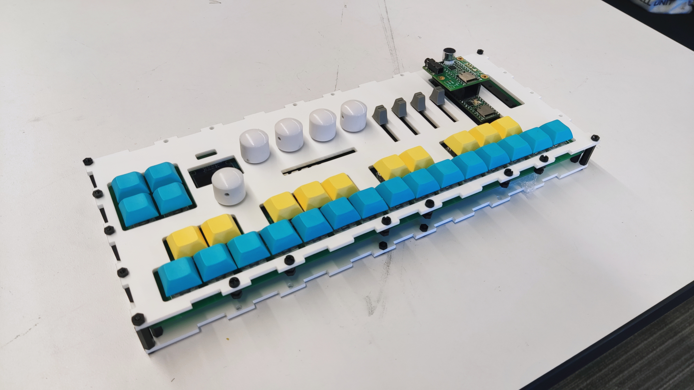
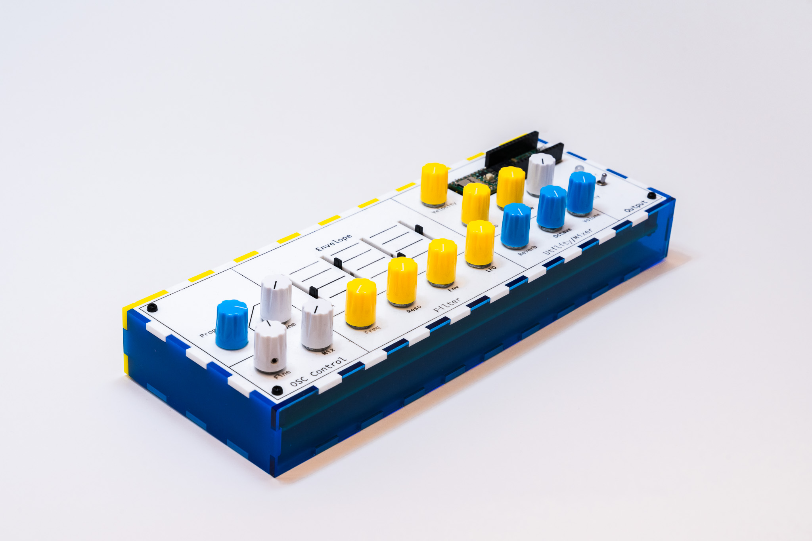

# TeensyLab Series: Custome MIDI Controllers for Musical Applications
<table align="center">
  <tr>
    <td align="center">
       
      <b>V1:</b>  TeensyLab V1
    </td>
    <td align="center">
       
      <b>V2:</b> TeensyLab V2
    </td>
  </tr>
</table>

V1: 
A recreation of artutia's minilab using Teensy 4.1 microcontroller, combining knowledge learned from electronics classes during my time at undergrad program of Music Tech at NYU. 

This project integrates multiple hardware components and libraries to bring functionalities similar to what minilab offers. While the vibrato and modulation controls were not implemented due to time constraints, the core functionality showcases effective integration and design.

V2:
It is a continuation of V1, inherited most of the core programming design, with upgraded interface design, and further integrates into a real-time guitar-to-synth performance system I built with MAX/MSP + JUCE plugin. 

## 📄 Project Report

V1: 
Detailed documentation and design rationale available in the [PDF Report](./V1_Report_Digital_Electronics_Final.pdf)

V2:
[Slides](./V2_Presentation_Capstone.pdf)  +   [Report](./V2_Report_Capstone.pdf)

---

## 🎥 Demo Video

V1: Watch the full demonstration on YouTube: [V1 Final Project Demo](https://www.youtube.com/watch?v=NRasdBVcbtc)

V2: controlling with plugin, and combing it with performance system: [V2 Final Project Demo](https://www.youtube.com/watch?v=ATFw36BjHuM)

---

V2 Picture Credits, Tomas: https://www.instagram.com/rentstabilizedphotography?igsh=YnQybHMyNTlqN254

